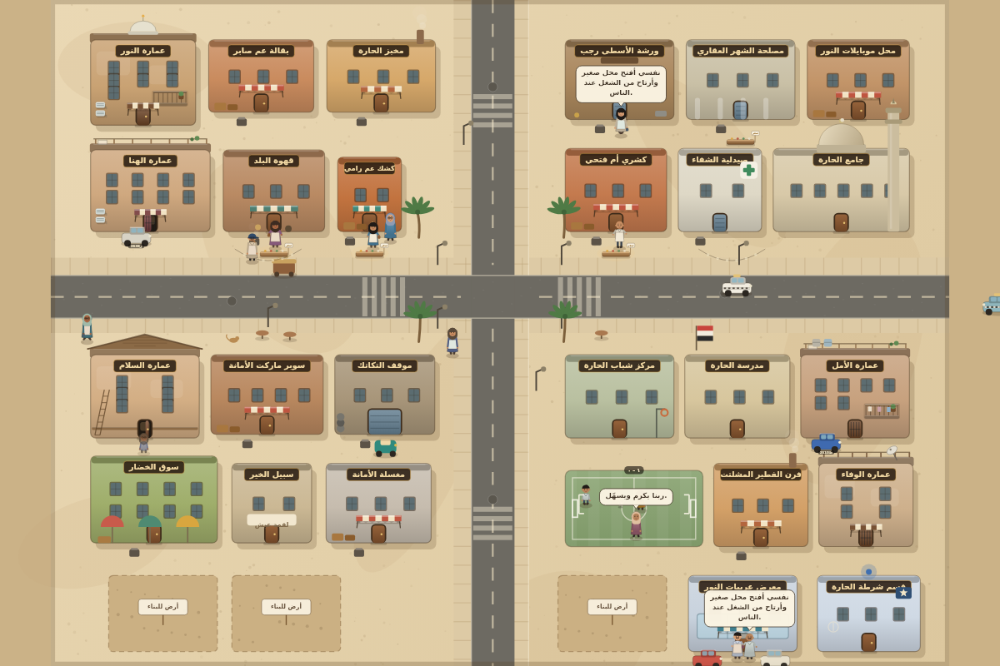

# خط إمبابة

لعبة قيادة ميكروباص ثلاثية الأبعاد تعمل في المتصفح، في منطقة مفتوحة محدودة مستوحاة من إمبابة. اتبع نقطة الموقف على الخريطة أو استكشف الشوارع والتقاطعات. توقّف بالقرب من كل موقف ليركب الركاب، ثم أوصلهم للمحطة الأخيرة.

في المحطة الأخيرة، ينزل الركاب: وجّه علامة منتصف الشاشة نحو كل راكب واضغط **E** أو زر «الم الأجرة». يمكن استخدام «بص للراكب» لتوجيه الكاميرا للراكب التالي. لا تُضاف الأجرة قبل نزول الركاب وجمعها منهم. بعد انتهاء الخط يمكن متابعة التجول أو بدء خط جديد.

- الأسهم أو WASD: القيادة، والسهم السفلي / S للرجوع للخلف. على الهاتف يوجد زر «رجوع» بجانب الفرامل والبنزين. يظهر الحرف R عند الرجوع.
- مسافة: الفرامل.
- C أو زر الكاميرا: التبديل بين منظور السائق والمنظور الخارجي.
- في منظور السائق: اسحب الشاشة بالماوس أو اللمس للبص حولك، أو استخدم J و L أو أزرار النظر. زر «قدام» يعيد النظر للأمام.
- E أو زر «الم الأجرة»: جمع الأجرة من الراكب الذي تنظر إليه.
- على الهاتف استخدم أزرار القيادة والنظر والكاميرا الظاهرة على الشاشة. عربيات المرور تهدّي وتقف لما الطريق مقفول، وفيه تصادم بينها وبين الميكروباص وبين بعضها.

لتشغيلها محلياً، شغّل خادم ملفات ثابت من المجلد (مثلاً `python3 -m http.server 8000`) ثم افتح الصفحة. لا تحتاج اللعبة إلى خادم خلفي؛ مكتبة Three.js موجودة محلياً في مجلد `vendor`.

---

# حياة الحارات

لعبة محاكاة حياة مصرية ثنائية الأبعاد في المتصفح. انت **الخالق**: بتستدعي حارة صغيرة، وتسكن فيها ناس مش حقيقيين، وكل واحد فيهم عنده عقل بيفكر لوحده — بيشتغل وياخد يومية، ياكل، يدفع فاتورة النور والمايه، يدفع إيجار الشقة، يقعد مع الناس في القهوة، يتعب وينام… وكل خاطرة وكل حركة بتتكتب في السجل بالتاريخ والوقت.



**اللعب:** من غير تحكم في الناس. بتتفرج بس.

- **استدعِ الحارة**: تولّد الحارة بشوارعها وعماراتها ومحلاتها (٥ عمارات سكن، بقالة، مخبز، قهوة، ورشة، مصلحة، صيدلية، جامع، مدرسة، ملعب، سوق، موقف تكاتك…).
- **اسكن واحد**: تضيف ساكن جديد؛ بيدور على شقة فاضية وشغل فاضي، ولو مفيش شغل بينزل يوميات.
- **البشر (قايمة حياة كل واحد)**: تاب «البشر» فيه كل ساكن بنوعه وسنه وشغله وفلوسه، وتحت كل اسم آخر كلامة. دوس على أي حد تفتح **بروفايله**: أصحابه ونسبة قربه منهم، اللي في قلبه ومين معجب بيه، كل كلامه المسجل (مع مين وإمتى)، وآخر اللي عمله — وفي زرار يوديك له في الحارة.
- **دوس على أي ساكن على الخريطة**: يظهر كارت فيه فلوسه وأكله وطاقته ومزاجه، وهو بيعمل إيه دلوقتي، وآخر خاطرة في دماغه.
- **السجل**: كل حاجة مكتوبة — خواطر، شغل، فلوس، أكل، كلام الناس، أحداث الحارة. فيه فلاتر (خواطر / فلوس / شغل / حياة / كلام / أحداث) وبتبدأ من الأحدث.
- **السرعة**: ⏸ / ١× / ٢× / ٤× (أو مسافة و ١ ٢ ٣ في الكيبورد).
- **الخواطر**: زرار «💭 الخواطر» بيظهر ويخفي بالونات الكلام فوق الناس.
- **الزوم**: عجلة الماوس أو أزرار ＋/－، واسحب المشهد للتنقل.

## الناس والشغل والكلام

- **رجالة وستات**: كل ساكن بيتولد بشكل مختلف — طول وبنية، هدوم (جلباب أو قميص وبنطلون، فستان/عباية وطرح)، شعر أو طاقية أو كاب، دقن وشوارب، نضارة، شنطة في إيده، ومريلة لو شغله في محل.
- **كلام بينهم**: الجيران بيسلّموا على بعض وبيتكلموا (فوق دماغهم بالون كلام أخضر)، والكلام بيتسجل بالاسم والتوقيت. العلاقة بتقرب بالكلام والبيع، وبتتدرج من غريب → صاحب → صاحب أوي، وساعات واحد فيهم بيروح خاطر قلبه لحد.
- **حاجات البيت**: كل شوية حد بينزل يجيب حاجة من السوق، وبيرجع البيت شايلها.

## المطاعم: طبخ ← كاونتر ← خدمة ← دفع

- البياع بيبدأ شغله في معاده، وبيدخل حالات متسلسلة: **بيطبخ** جنب البوتاجاز (لهب ودخان)، بعده **شايل الأكل** على صينية لحد الكاونتر، وبعدها **بيخدم** الزباين. الحالة مكتوبة في شريحة فوق دماغه (🔥 بيطبخ / 🍽️ شايل الأكل / 🤝 بيخدم).
- **الزبون** بيدخل، يقف في **طابور** قصاد الكاونتر، **يطلب**، يستلم، **يدفع**، وبعدها ياكل على طربيزة جوه المحل أو يمشي. كل خطوة ليها شريحة (🧍 في الطابور / 🗣️ بيطلب / 💰 بيدفع / 🍽️ بياكل).
- **المخزون** بيتفضّى مع البيع وبيتعاد تعبئته كل شوية. لو خلص: يافطة المحل بتبقى **«خلص الأكل»** والزباين تمشي من غير أكل — والسجل بيكتب السبب. ولو مفيش بياع: **«مفيش بياع»**، وبره المواعيد: **«مقفول»**.
- كارت أي محل بيوريك: مفتوح ولا مقفول وليه، مين البياع، مواعيده، المخزون، الطابور، وبيع النهاردة.

## الدخول جوه المباني

- دوس **دخول** في كارت أي محل أو بيت (أو كليك على الباب وانت قريب) — الكاميرا بتعمل **انتقال** جوه الأوضة: أرضية خشب، رفوف، لمبات معلقة، بوتاجاز وكاونتر وطربيزات في المحل، وكنبة وتليفزيون وسرير في البيت.
- الناس بتفضل شغالة جوه: الطباخ بيطبخ، الزباين بيدخلوا ويقفوا في الطابور ويقعدوا ياكلوا — وكل واحد في مكانه الصح. لوحة صغيرة تحت بتوريك حالة المحل والمخزون/الطابور/البيع (أو ساكنين/شقق/إيجار في البيت).
- **خروج** (أو `Esc`) بيرجّعك لنفس المكان اللي دخلت منه بالظبط، بنفس الزوم والكاميرا.

## العيلة والجواز

- العلاقة بتزيد بالكلام والبيع. لما توصل لآخر مدى، ممكن يحصل **ارتباط** وبعده **جواز** — والسجل بيكتب الفرح.
- الجواز بيحتاج **شقة فاضية**، وبيربط الاتنين ببعض (زوج/زوجة)، وبيعمل **عيلة** ساكنة في نفس الشقة. مفيش جواز لنفس الشخص مرتين، ولا جواز لأقارب من نفس العيلة، ولا جواز لأطفال.
- **الأطفال** بيتولدوا للعيلات المتجوزة، بيكبروا مع الأيام، بيروحوا المدرسة ويلعبوا، ولما يكبروا بيدوروا على شقة وشغل. كارت البروفايل فيه قسم **«العيلة والبيت»**: الزوج/الزوجة، الوالدين، الأولاد بأعمارهم، والبيت والإيجار.
- كل ده بيتحفظ ويتحمّل زي ما هو: بعد أي حفظ/تحميل، الزوجين لسه مربوطين ببعض والعيلات سليمة.

## مركز البناء والإيجار

- تاب **«البناء»** فيه: إحصائيات الحارة، **البيوت** (مين ساكن، الشقق الفاضية، الإيجار)، **الأراضي الفاضية** اللي تقدر تبدأ عليها بناء، و**المشاريع** اللي شغالة بنسبة الإنجاز.
- اضغط **«ابدأ البناء هنا»** على أرض فاضية: بتتحول لورشة، بيتفتح شغل **عامل بناء**، والسكان بياخدوا الشغل ده لوحدهم. البناء بيتقدّم في ساعات النهار بس (٧ الصبح → ٧ بالليل)، وبيبان على الخريطة: حوائط بتطلع دور ورا دور، سقالة، وطوب، وشريط نسبة مئوية باسم المشروع.
- لما يخلص: الأرض بتبقى **عمارة بشقتين**، صاحب المشروع (لو فيه) بيتنقل لها هو وعيلته، والشقة التانية بتتعرض **للإيجار** — وسكان جدد بياخدوها. تاب «السوق» بيوريك الشقق الفاضية بأسعارها.
- مفيش عيلتين في شقة واحدة، ومفيش مشروعين على نفس الأرض، والفلوس بتتخصم مرة واحدة بس عند بداية البناء.

## الليل والنوم

- بعد **١٠:٣٠ بالليل** الناس بترجع بيوتها واحدة واحدة، النور بيطفي، والشوارع بتبقى ساكتة. اللي لسه صاحي بيبان في القايمة باسمه.
- زرار **«🌙 نم لحد الصبح»** في الهيدر بيقفل الليل كله على طول. لو فيه ناس لسه صاحية، الزرار بيكتب **«🌙 ٩/١٤ نايمين»** ولو دوس عليه يقولك مين صاحي ومش بينفّذ.
- أول ما حد يصحى، بيعدّي على الباب، بيطلع، وبيبدأ يومه من غير ما يحصل حاجة غريبة في الحالة.

## الباب بيتفتح (الدخول والخروج)

- أي ساكن بيدخل بيته أو محله بيمر على الباب: **الباب بيتفتح**، الشخص بيصغّر ويدخل جوه، والباب بيتقفل وراه. والخروج بنفس الشكل بالعكس.
- الأنيميشن ليه مدة محسوبة (الدخول جوه البيت عند ٥٥٪ من الحركة، وبيخلص عند ١١٥٪)، وطول ما هو داخل/خارج بتبان حالته في كارت البروفايل.
- وانت قريب (زوم عالي) بتشوف الوشوش والناس بتدخل وتخرج من البيوت والمحلات.

## كورة الحارة

- **ملعب الحارة**: العيال بتنزل تلعب ماتشات على فترات. الكورة بتتحرك بين اللاعيبة، فيه جولين، والنتيجة بتتكتب فوق الملعب (**١ – ٢**) وكل جون بيتكتب في السجل («جووون…»).
- **ماتش في نص الشارع**: ساعات العيال بتعمل جولين من الطوب على الأسفلت وتلعب في وش العربيات — و**العربيات بتقف تستنى** لحد ما الماتش يخلص (ساعة المرور بتقف، ومفيش عربية بتعدّي).
- عشان الكورة تبقى موجودة من أول يوم، الحارة بتبدأ بعيلتين وعيالهم (والعيال بيكبروا مع الأيام وبيبقوا ساكنين لوحدهم).

## السرقة والشرطة

- **قسم شرطة الحارة** بيفتح بظابط شغال طول اليوم. وفي الحارة ناس عندها استعداد تسرق (واحد من كل ~٦).
- الحرامي بيدبّر سرقة بالليل (بين ٢٠:٠٠ و٠١:٣٠ تقريباً): بيقوم من النوم، بيروح لبيت غريب، والفلوس بتتخصم من الضحية فعلًا.
- الضحية بتكتشف الصبح، بتنزل تبلّغ، والقسم بيبعت **دورية**. الظابط بيروح المكان ويعاين، وبعدها إما **يقبض على الحرامي ويرجّع الفلوس**، أو القضية **تبرد** لغياب الدليل.
- ممكن يتقبض عليه **في اللحظة** لو البيت عامل قفل جديد أو فيه دورية قريبة — وساعتها الفلوس ما بتتحركش.
- كل حادثة ليها **علامة على الخريطة** (نور أحمر/أزرق بينوّر مكان الجريمة)، وسجل في البروفايل («سابقة في القسم»)، وبيت الضحية بيركّب **قفل جديد** بعد السرقة (الأمان بيزيد من ١ لـ٣).
- البروفايل بيعرض: نايم/محبوس/صاحي، عربيته، مشواره، وسجله الجنائي.

## معرض العربيات والمشاوير

- **معرض عربيات النور**: عربيات معروضة (فيات ١٢٨، توك توك، فيرنا، بيك أب، وتوك توك مستعمل)، وبيبان على الخريطة بعربيتين في الفاترينة ونور في السقف.
- من كارت المعرض تختار ساكن: **كاش** أو **تقسيط**. التقسيط **مقدم ٣٥٪** والباقي بيتحصّل **كل يوم** من فلوسه، وفي البروفايل سطر «قسط العربية: فاضل كذا • بيتحصّل كذا في اليوم». أول ما يتقفل، العربية بتبقى خالصة.
- العربيات بتركن عند بيت صاحبها، بتمشي في الشارع، وبتنوّر بالليل. والسكان بيشتروا لوحدهم (كاش أو تقسيط) لو معاهم فلوس.
- **المشاوير**: راكب بيطلب عربية من مكان لمكان، المعرض بيبعتله سواق، الأجرة بتتخصم من الراكب وتتضاف للسواق (بعد عمولة المعرض)، والسجل بيكتب المشوار والفلوس. كارت المعرض بيوري السواقين والمشاوير الشغالة والعربيات المركونة.

## العمدة: إدارة الحارة

- تاب **«🏛️ العمدة»** بيوريك الحارة من فوق: **خزنة الحارة**، الضرايب المتأخرة، مين العمدة، وآخر القرارات.
- **الأدوار والصلاحيات**: عمدة (كل الأوامر) / مجلس الحارة (تحصيل، إيجار، خدمات) / مراقب (قراءة بس). كل أمر بيمر على نفس بوابة الصلاحيات — لو الدور مالوش صلاحية، الأمر بيترفض، والعمدة الآلي بيمشي على نفس البوابة بالحرف.
- **الضرايب**: ضريبة سكان (بالنسبة من دخل الساكن، أقصاها ١٥٪) وضريبة أنشطة (على مبيعات المحلات اللي ليها صاحب، أقصاها ٢٠٪). اللي مش معاه فلوس بتتراكم عليه **متأخرات** وبتبان في تقريره.
- **التحصيل**: دوس «حصّل الضرايب» — الخزنة بتزيد، وكل ساكن بيخصم من فلوسه على قد اللي معاه (مفيش رصيد بالسالب).
- **الخزنة**: **منح** لساكن (بحد أقصى الخزنة، والمنح الكبيرة بتحتاج تأكيد)، و**غرامات** (بحد ٥٠٠ ج.م، والباقي بيتسجل متأخرات).
- **الإسكان**: نقل ساكن (أو عيلته كلها) لبيت تاني لو فيه شقة فاضية، **قفل/فتح الإيجار** في عمارة (المقفولة مش بتستقبل سكان جداد)، و**طرد** من البيت — الطرد **مش مسموح** لو ده آخر بيت في العمارة من غير بديل يسكنه، ومش مسموح تطرد العمدة نفسه.
- **المتطفّلين**: أي حد ساكن في بيت مش بتاعه (أو داخل شقة من غير حق) بيتعلّم في التقرير كـ«ساكن بدون حق»، والعمدة يقدر يخرجه من البيت.
- **الخدمات**: نور الشوارع، المايه، وخدمة الشرطة (قفلها = مفيش دوريات ولا قبض)، و**تغطية الشرطة** (خفيفة / عادية / مكثفة) بتأثر على سرعة الدورية واحتمال القبض.
- **العمدة الآلي**: زرار في التاب — لو شغّلته بيدير لوحده (تحصيل، رفع ضريبة بسيط لو الخزنة فاضية، منح للغلابة، إسكان اللي بلا مأوى، وإخراج المتطفّلين) **بنفس الأوامر ونفس الحدود**، ومش بيقدر يخالف أي قاعدة.
- كل قرار خطير بيعدّي على **صندوق تأكيد** فيه نص واضح، والتأكيد بيسقط بعد ٩٠ دقيقة محاكاة وبيتستخدم مرة واحدة بس.

## الشرح التفاعلي

- أول ما تستدعي الحارة بيظهر **كارت شرح** في الركن: عنوان، وصف قصير، والمهمة المطلوبة منه.
- الشرح مربوط بالفعل الحقيقي مش بخطوات على الورق: افتح ملف ساكن، خلّي حد ياكل، ادخل محل، خلّي اتنين يتكلموا، ابني مشروع، جواز أو مولود، حد يسكن، عدّي ليلة، ماتش كورة، حادثة أو قبض، عربية أو مشوار، وأخيرًا افتح تاب العمدة وحصّل ضرايب.
- فيه **إيقاف مؤقت**، **«تالي»** لو عايز تعدّي خطوة، **تخطي الشرح** كله، وزر **«؟ الشرح»** في الهيدر يعيده من الأول في أي وقت — وتقدمه بيتحفظ مع اللعبة.

## بيوت مختلفة الشكل

- كل عمارة ليها شكل: **سطح مسلّح بدرابزين**، أو **سقف قرميد مايل**، أو **قبة وفنار**، أو **سطح بسلّم وصندوق سلم وزرع**، أو **سلّم حديد على الحيطة**.
- وفيه تفاصيل بتنوّع الواجهات: بلكونة حديد جنب الباب (بغسيل وسريَر شتلة)، مظلة فوق الباب بقوايم، شبابيك بشيش، قرميد قاعدة، مكيفات، طبق دش على السطح، تنكات مايه، سلّم خارجي، ودهان مختلف لكل حي (شرقي/غربي).
- الشكل بيتولّد من اسم العمارة وموقعها، وثابت بعد كده — بيتحفظ ويرجع زي ما هو.

## سرعة الوقت

- الوقت الافتراضي: **يوم كامل = ١٥٠ ثانية حقيقية** بسرعة ١× (أطول من الأول بـ٢٥٪)، وسرعات ٢× و٤× بتقصّروه.
- `setDayLength(مضاعف)` بيطول أو يقصّر اليوم (٠٫٢٥× لحد ٤×)، وبيتحفظ مع اللعبة.

## الحفظ

- اللعبة **بتتحفظ لوحدها** كل ١٥ ثانية وفي الخلفية لما تسيب الصفحة، وفيه زرار **«حفظ»** في الهيدر. أول ما تفتح تاني بتكمل من نفس اللحظة (نفس اليوم والسكان والفلوس والعيلات والمشاريع والسجل).
- كل الجديد بيتحفظ كمان: **العربيات** (النمرة ومكان الركن والتقسيط)، **المشاوير**، **الجرائم والقضايا** (مين اتقبض عليه والفلوس اللي رجعت)، **أقساط العربيات**، وحالة الليل.
- الحفظ بقى **نسخة ٥** — وبيحفظ كمان **العمدة** (الخزنة والضرايب والمتأخرات والخدمات والغرامات والقرارات)، **تقدم الشرح**، و**شكل كل بيت**. والحفظ القديم (v4 و v3) بيتقرا ويتطوّر لوحده أول ما تفتح اللعبة، فمش هتخسر حارتك.
- التحميل ممكن يرفض حفظ بايظ من غير ما يكسر اللعبة.

## الاختبار

من غير متصفح — اختبارات المنطق في Node:

```bash
node harat/tests/sim.test.mjs
```

بتغطي (١٨ قسم، ~١٨٥ تحقق): خدمة المطاعم والمخزون والطوابير، المحل من غير بياع/مقفول/خلص الأكل، الجواز ومنع التكرار (والجواز لما الشقق تخلص)، الأطفال والعيلة، البناء لحد التسليم، الحفظ والتحميل، **الليل والنوم وتخطي الليل**، **أنيميشن الباب والدخول**، **ماتش الكورة والأهداف**، **السرقة والشرطة والقبض والتورية**، **شراء العربية والمشاوير والأقساط**، **صلاحيات العمدة والخزنة والضرايب والمنح والغرامات والطرد والإسكان والمتطفّلين والخدمات**، **العمدة الآلي**، **الشرح التفاعلي**، **طول اليوم**، **تنوّع البيوت وثباتها بعد الحفظ**، وقبول الحفظ القديم.

وفي كمان سكربت استقرار ٣٠ يوم (سكان، عربيات، جرائم، ماتشات، حفظ ١٣٠ كيلو) بيتشغل من غير متصفح لو عايز تطمن على المدى الطويل.

وللتجربة اليدوية: استدعي الحارة وامشي مع كارت الشرح → سرّع ٤× → افتح محل كشري أو مخبز وشوف الطبخ والطابور → ادخل جوه المحل → ارجع → بص على تاب «البناء» وابدأ بناء على أرض فاضية → سيبها تشتغل لحد ما تخلص → اعمل حفظ، اعمل ريفريش، وكمّل.

وكمان: استنى لبعد ١٠:٣٠ بالليل واضغط **«🌙 نم لحد الصبح»** → الصبح افتح تاب **«الشارع»** واتفرج على ماتش كورة (أو استنى ماتش الشارع بالعربيات واقفة) → بالليل استنى بلاغ سرقة وشوف علامة الشرطة والدورية → افتح كارت **معرض العربيات** واشتري عربية لحد **بالقسط** → وشوف البروفايل بيوري القسط والسجل الجنائي والعربية.

## ملفات اللعبة

- `harat/index.html` — الواجهة (لوحة السجل، الكروت، شاشة البداية).
- `harat/style.css` — التصميم (RTL، خط Cairo، ألوان الحارة).
- `harat/dialogue.js` — محرك الكلام: مواضيع جاهزة بلهجة الحارة، اختيار بوزن الحداثة ومنع التكرار، وربط الكلام بالوقت والحدث.
- `harat/mayor.js` — أدوار وصلاحيات العمدة، أوامر الإدارة وحدودها، وحالة الخزنة والضرايب والخدمات.
- `harat/tutorial.js` — خطوات الشرح اللي بتتحقق من حالة اللعبة الحقيقية.
- `harat/sim.js` — عقل اللعبة: الاقتصاد، الوقت، قرارات السكان، العلاقات والكلام، المطاعم والطوابير، العيلات والجواز، البناء والإيجار، **الليل والنوم، الجرائم والشرطة، ماتشات الكورة، العربيات والمشاوير والأقساط**، الحفظ (`serialize` / `hydrate`)، السجل (من غير أي DOM).
- `harat/tests/sim.test.mjs` — ١٨ قسم اختبارات منطق (من غير متصفح).
- `harat/app.js` — الرسم على Canvas 2D + الكاميرا + الواجهة.
